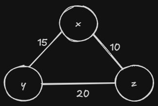
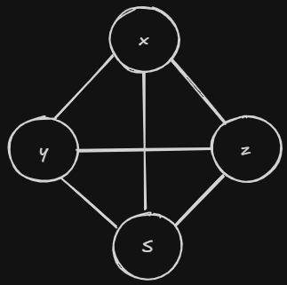

# Estruturas de grafos
*"Um grafo é uma estrutura de dados usada para representar relações entre elementos."*
Ele é formado por: 
  - Vértices (nós): representam os elementos
  - Arestas: representam as conexões entre os vértices
G = (V, E) 
V = conjunto de vértices
E = conjunto de arestas

Exemplo:
- Vértices > Cidades
- Arestas > Estradas

## Tipos de Grafos

1. ### Grafo não direcionado
    As conexões não tem sentindo  
    A -- B  
    Se A conecta com B, B conecta com A.  
2. ### Grafo direcionado
    As conexões tem sentido  
    A -> B  
    A se conecta com B, mas B não necessariamente conecta com A  
3. ### Grafo ponderado ou valorado
    As arestas têm peso, por exemplo: distância entre cidades, custos, tempo, etc.  
      
4. ### Grafo não ponderado
    As arestas não possuem peso.
5. ### Grafos Completos
    Um grafo completo é aquele em que todos os seus vértices são adjacentes aos pares, ou seja, existem arestas presentes entre todos os pares de vértices.  
      
## Representações de Grafos

1. ### Matriz de adjacência
    Uma matriz V x V que indica se há conexão
    - Vantagem: acesso rápido  
    - Desvantagem: usa muita memória  
2. ### Lista de Adjacência
    Cada vértice tem uma lista de seus vizinhos.

    Vantagem: mais eficiente em memória
    Muito usada na prática.